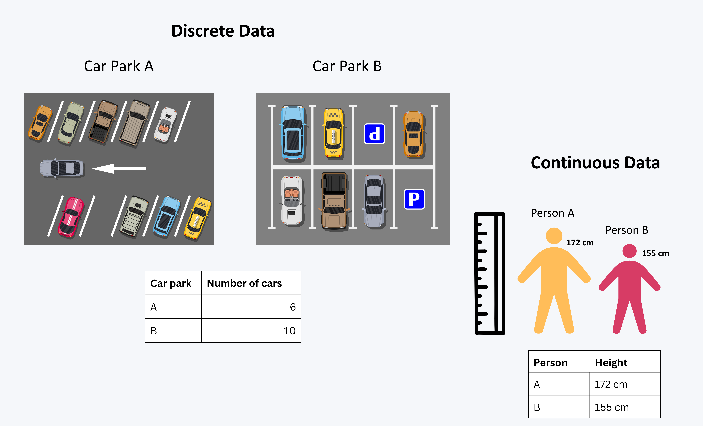
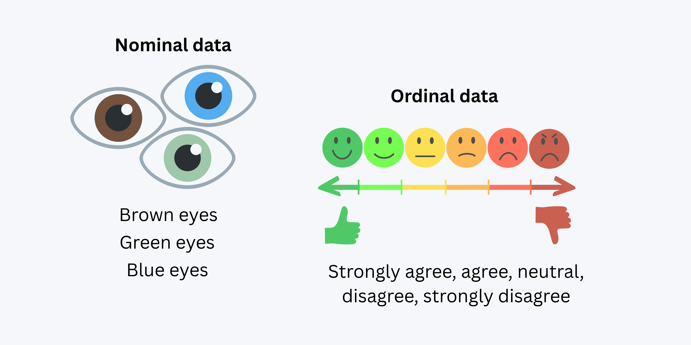

Using what we learnt in the Exploratory Data Analysis chapter, we will now explore our skills using various case studies to answer some questions. 

To recap... 

### TERMINOLOGY ! 

We learnt about **4 types of data**, within **2 different groups.**   

#### Quantitative/Numerical data

Data that can be measured and expressed numerically. It can be further classified into discrete and continuous data.

**Discrete data:** Data that can only take *specific* values, often counted. Examples include the *number of students in a class* or the *number of cars in a parking lot*.

**Continuous data:** Data that can take any value within a range, often measured. Examples include *height*  and *temperature*.

{width=60%, fig-align="center"}

#### Qualitative/Categorical data

Data that can be divided into categories or groups. It can be further classified into nominal and ordinal data.

**Nominal data:** Data that represents categories without any inherent order. Examples include; *eye color*, and *types of fruits*.

**Ordinal data:** Data that represents categories with a meaningful order. Examples include *education level*, *satisfaction ratings*, and *size of clothing*.

{width=60%, fig-align="center"}

### Summary Statistics 

Summary Statistics are used to summarise and describe the main features of a dataset. They provide a quick overview of the data, allowing us to understand its central tendency, variability, and distribution.

#### Measures of averages:
**Mean**           
The total of all the values divided by the number of values.

**Median**  
The middle value when the data is arranged in order.
                                     
**Mode**                            
The value that occurs most often.
        
#### Measures of spread:
**Range**          
The difference between the largest and smallest values.
                 
**Standard deviation**                
A measure of how spread out the values are around the mean.
     

Our mean and our standard deviation are the most commonly used summary statistics. The mean gives us an idea of the central tendency of the data, while the standard deviation tells us how much the data varies from the mean. 

**Skewness**

