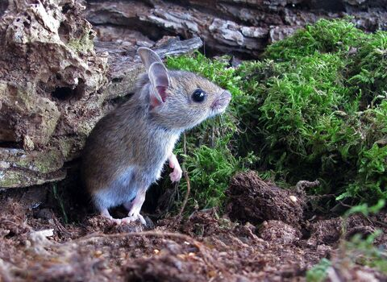

Using what we have just learnt in the [Exploratory Data Analysis Chapter](https://ellenbell.github.io/7056A/workshop-2---explorartory-data-analysis.html), we will now do a small recap, and explore these skills using a
 different  example. 

To recap... 

## Getting the Terminology Right 

We learnt about **4 types of data**, within **2 different groups.**   

### Quantitative data

Data that can be measured and expressed numerically. It can be further classified into discrete and continuous data.

**Discrete data:** Data that can only take *specific* values, often counted. Examples include the *number of students in a class* or the *number of cars in a car park*.

**Continuous data:** Data that can take any value within a range, often measured. Examples include *height*  and *temperature*.

{width=60%, fig-align="center"}


### Qualitative data

Data that can be divided into categories or groups. It can be further classified into nominal and ordinal data.

**Nominal data:** Data that represents categories without any inherent order. Examples include; *eye colour*, *gender*, and *types of fruit*.
**Ordinal data:** Data that represents categories with a meaningful order. Examples include *education level*, *satisfaction ratings*, and *size of clothing*.

{width=60%, fig-align="center"}


## Summary Statistics 
We know about summary statistics from the [main workbook](https://ellenbell.github.io/7056A/workshop-2---explorartory-data-analysis.html#summary-statistics) - they are used to summarise and describe the main features of a dataset, and provide a quick overview of the data, allowing us to understand its central tendency, variability, and distribution.


### Measures of averages:
**Mean**           
The total of all the values divided by the number of values.

**Median**  
The middle value when the data is arranged in order.
                                     
**Mode**                            
The value that occurs most often.
        
### Measures of spread:
**Range**          
The difference between the largest and smallest values.
                 
**Standard deviation**                
A measure of how spread out the values are around the mean.
     
**Skewness**              
The measure of asymmetry in the distribution of data. A positive skew indicates a longer tail on the right side, while a negative skew indicates a longer tail on the left side. Skewness tells you where the outliers or extreme values are pulling the distribution, relative to where most of your data sits.                         


## Checking Data for real -  Using the Wood Mouse! 

Let's use what we've learnt using a dataset. 

{fig-align="left"}

Meet *Apodemus sylvaticus*, the [wood mouse](https://www.wildlifetrusts.org/wildlife-explorer/mammals/wood-mouse). *Apodemus sylvaticus* can often be found with the parasite, gastrointestinal roundworm, *Heligmosomoides polygyrus*.

We have a dataset where researchers took a sample of 60 different *Apodemus sylvaticus*, checked their (i) sex, (ii) weight, and (iii) the count of parasites present. 

Let's first read in this dataset, found in `data/mouse_parasite_counts.csv`. 

Before we do this, you'll need a package for it to run. If you remember from earlier in the [main workbook](https://ellenbell.github.io/7056A/workshop-2---explorartory-data-analysis.html#task-2-importing-the-data), we used the function `read_csv()`, which comes from the package `readr`. However, `readr` is part of the `tidyverse` package, which actually contains A LOT of different packages - you can read about this in the [Appendix Chapter](appendix.qmd). 

**Good practice alert!!** It is *excellent* practice to load up all the packages you will need at the start of your script, so you don't forget to load them later on, and they are not scattered all over your code, this is another thing you can read about in the [Appendix Chapter](appendix.qmd).         

We will use the following packages throughout this script: `tidyverse` (for data wrangling and visualisation), `janitor` (for data cleaning), `kableExtra` (for creating formatted tables) and `DescTools` (for calculating summary statistics). Make sure these are installed from the **console** using `install.packages()` *before* loading them into your script with `library()`.     

```{r, results='hide', message=FALSE, warning=FALSE}
library(tidyverse)
library(janitor)
library(kableExtra)
library(DescTools)
```

```{r, results='hide', message=FALSE, warning=FALSE, echo=FALSE}
library(webexercises)
```

If the `tidyverse` package is installed and loaded up, you should be able to read in the dataset. 

```{r, results='hide', message=FALSE, warning=FALSE}
mice_parasites <- read_csv("data/mouse_parasite_counts.csv")
```

Let's apply what we learnt earlier to inspect the data, using the functions we explored in the main workbook. These different data checks can be grouped into different categories:             
                                     
(i) Dimensions/Size         
(ii) Structure/variable names           
(iii) Viewing the actual data           
(iv) Starting to summarise the data      
               
There are functions you can use on this related to `Base R`, `tidyverse`, and `janitor`. Let's have a look at some of these functions below, and then answer some questions about the data.

```{r, results='hide', message=FALSE, warning=FALSE}
# (1). Dimensions/Size:
nrow(mice_parasites) # number of rows, Base R
ncol(mice_parasites) # number of columns, Base R

# (2). Structure/Variable Names:
colnames(mice_parasites) # variable names, Base R
str(mice_parasites) # summary of the data structure, Base R
glimpse(mice_parasites) # summary of the data structure, tidyverse

# (3). Viewing the Actual Data: 
head(mice_parasites) # first 6 rows, Base R
tail(mice_parasites) # last 6 rows, Base R

# (4). Starting to Summarise the Data: 
summary(mice_parasites) # summary of the data, Base R
tabyl(mice_parasites, sex) # frequency / percentage, janitor
```


::: {.callout-note collapse="true" title="Dimensions/Size"}
```{r}
nrow(mice_parasites) # number of rows, Base R
ncol(mice_parasites) # number of columns, Base R
```
:::

::: {.callout-note collapse="true" title="Structure/Variable Names"}
```{r}
colnames(mice_parasites) # variable names, Base R
str(mice_parasites) # summary of the data structure, Base R
glimpse(mice_parasites) # summary of the data structure, tidyverse
```
:::

::: {.callout-note collapse="true" title="Viewing the Actual Data"}
```{r}
head(mice_parasites) # first 6 rows, Base R
tail(mice_parasites) # last 6 rows, Base R
```
:::

::: {.callout-note collapse="true" title="Starting to Summarise the Data"}
```{r}
summary(mice_parasites) # summary of the data, Base R
tabyl(mice_parasites, sex) # frequency, janitor
```

:::

        
**1. How many rows does the dataset contain?** In this case, it will tell us how many different samples of *Apodemus sylvaticus* were taken. 

`r mcq(c("30", "45", answer = "60", "75"))`

**2. How many variables (columns) are in the dataset?** In this case, it will tell us how many different measurements were taken for each sample.

`r mcq(c("2", answer = "4", "5", "6"))`

**3. Which function would you use to see the first few rows of the data?**

`r mcq(c("tail()", answer = "head()", "glimpse()", "nrow()"))`

**4. Which package does `glimpse()` come from?**

`r mcq(c("base R", answer = "dplyr (tidyverse)", "janitor", "readr"))`

**5. What is `tabyl()` used for?**

`r mcq(c(answer = "frequency table of a categorical variable", "calculating the mean", "reading in a csv file", "plotting a graph"))`

**6. Which package is `tabyl()` from?**

`r mcq(c("tidyverse", answer = "janitor", "base R", "readr"))`

### Using Histograms to Visualise the Data

We also learnt about histograms, which are a great way to visualise the distribution of a single variable. From this, we can see where the data is concentrated (if the data is distributed symmetrically), and if there are any outliers (extreme values).

Notice `binwidth` in our code below. This controls the width of each bar in the histogram. A smaller binwidth produces more bars, showing finer detail in the distribution, while a larger binwidth produces fewer bars, giving a smoother overview. 

Let's use this to look at the distribution of the `parasite_count` variable.
```{r}
ggplot(mice_parasites, aes(x = parasite_count)) +
  geom_histogram(binwidth = 1, fill = "lightblue", colour = "black") 
```

You can see that choosing a binwidth of 1 produces a large number of bars, which gives a more detailed view of the distribution. If we were to increase the binwidth, we would see fewer bars, and a smoother overview of the distribution.

**What can we tell about where the data is concentrated? Is it skewed? If so, in which direction?**

`r longmcq(c("answer" = "The data is concentrated at low values (near 0), with a long right tail, positively (right) skewed", "The data is concentrated at high values, with a long left tail, negatively (left) skewed","The data is symmetric with no skew","The data is bimodal with two equal peaks"))`


`r hide("Show explanation")`
Most of the data sits on the left (0–3), and the long thin tail stretches out to the right (up to 27) — and since skew is named after the tail direction, this is positive (right) skew
`r unhide()`

If data is skewed, this can also tell us about the relationship between the mean and median. If the mean is above the median, this is a good indication that the data is right skewed, and if the mean is below the median, this is a good indication that the data is left skewed.

### Summary Statistics of the Wood Mouse Data

As described above, we learnt about the Mean, Standard Deviation, Median, Mode, Range, and Skewness. Let's calculate some of these for the `parasite_count` variable.

We learnt about the `group_by()` and `summarise()` functions to look at the mean. Here, let's look at the mean parasite count by sex. So we've got to group the data by sex, and then summarise the mean parasite count for each sex.

```{r}
mice_parasites_sex_summary <- mice_parasites %>%
group_by(sex) %>%
    summarise(
      n = n(),
      mean_parasite_count = mean(parasite_count)) 


mice_parasites_sex_summary
```


Now we have looked at how parasite counts differ by sex. Please answer the question below.

**1. What's this saying about how parasite counts differs by sex** 

`r mcq(c(answer = "Male mice have a higher mean parasite count than female mice", "Female mice have a higher mean parasite count than male mice", "Male and female mice have exactly the same mean parasite count", "There's no way to tell from this table"))`


We now know that parasite counts differ by sex,  we don't yet know if this is statistically significant though (we will begin looking at this in the next chapter), but for now, let's use what we've learnt today about data types to understand what variables we have in this dataset. 

Going back to [the Terminology section](#getting-the-terminology-right), we know there are different variables / data types in 2 different categories. What data types do we have in this dataset?

To help you out, let's run `colnames()` again, the code which will show us our variable names: 
```{r}
colnames(mice_parasites) # variable names, Base R
```

Our output shows the four things that were measured: 

"host_id", "sex", "weight_g", "parasite_count"

Categorise each of these variables:

**"host_id"** 
`r mcq(c("continuous", "discrete", "ordinal", answer = "nominal"))`

**"sex"** 
`r mcq(c("continuous", "discrete", "ordinal", answer = "nominal"))`

**"weight_g"**
`r mcq(c(answer = "continuous", "discrete", "ordinal", "nominal"))`

**"parasite_count"**
`r mcq(c("continuous", answer = "discrete", "ordinal", "nominal"))`

Now that we know what type of data we have, we can see if we can use the appropriate summary statistics to describe the data, including the weight.

If you completed the questions above, you will have seen that `weight_g` is a continuous variable. Unlike `sex`, which is categorical, weight cannot be neatly summarised into a small number of groups, and we can't simply see how parasite count differs by weight. However, as a first step, we can instead use the mean to describe the distribution of `weight_g`, and explore whether this differs by sex.

```{r}
mice_parasites_weight_summary <- mice_parasites %>%
group_by(sex) %>%
    summarise(
    mean_weight = mean(weight_g))

mice_parasites_weight_summary
```

While this does not tell us anything about the effect of parasites on weight, we can see that the mean weight of male mice is slightly higher than that of female mice. However, the difference is small and we would need a statistical test to determine if this difference is significant.
      
It is also worth noting the relationship between the **mean** and **median** as a measure of symmetry: when the two are close together, this suggests the data are roughly **symmetric**. When they are further apart, this suggests the data are **skewed**.


To explore our weight variable further, we can use what we learnt about histograms to visualise the distribution of weight. As before, let's keep the bin width at 1 for a finer view of the distribution.
```{r}
# Distribution of weight on its own
ggplot(mice_parasites, aes(x = weight_g)) +
  geom_histogram(binwidth = 1, fill = "lightblue", colour = "black") 

```


**In which direction is the data skewed?**

`r longmcq(c("The data is concentrated at low values (near 0), with a long right tail, positively (right) skewed", "answer" = "The data is concentrated at high values, with a long left tail, negatively (left) skewed","The data is symmetric with no skew","The data is bimodal with two equal peaks"))`


`r hide("Show explanation")`
The bulk of the data sits in a tight cluster around 19 – 24 g, with the tallest bars there. The longer, thinner tail pointing toward lower values makes it left-skewed.
`r unhide()`

So, from this plot - although we cannot infer anything about parasite count, we can tell that more mice are in the 20-30g range than below 20g, this makes sense by looking at our `mice_parasites_weight_summary` table above.


We still have a bit more to look at. We have covered the mean of multiple variables, but have not yet explored the remaining summary statistics.

Like earlier, and in the [main workbook](https://ellenbell.github.io/7056A/workshop-2---explorartory-data-analysis.html#summary-statistics), we can use the `summarise()` function to also calculate the median, mode, range and standard deviation of these variables.

We learnt in the [main workbook](https://ellenbell.github.io/7056A/workshop-2---explorartory-data-analysis.html#summary-statistics), that the mean can be calculated using the `mean()` function, the standard deviation can simply be calculated using the `sd()` function, and median can be calculated using the `median()` function. All work within `summarise()`.

```{r}
mice_parasites_summary_all <- mice_parasites %>%
  summarise(
    median_weight = median(weight_g),
    mean_weight = mean(weight_g),
    sd_weight = sd(weight_g),
    median_parasite_count = median(parasite_count),
    mean_parasite_count = mean(parasite_count),
    sd_parasite_count = sd(parasite_count),
  )

mice_parasites_summary_all
```

Recalling the definitions of these terms, what can we tell about the data? 


**1. Comparing the mean (21.5) and median (21.0) for `weight_g`, what can we say about its distribution?**

`r mcq(c(answer = "It's roughly symmetric, since the mean and median are close together", "It's strongly right-skewed", "It's strongly left-skewed", "There isn't enough information to tell"))`

**2. Comparing the mean (3.42) and median (0.5) for `parasite_count`, what can we say about its distribution?**

`r mcq(c("It's roughly symmetric", answer = "It's right-skewed, since the mean is pulled well above the median", "It's left-skewed, since the mean is pulled well below the median", "The two values should always be identical"))`

**3. Why is the mean so much higher than the median for `parasite_count`?**

`r mcq(c("Because most mice have very high parasite counts", answer = "Because a small number of mice with unusually high parasite counts are pulling the mean upward", "Because the median is calculated incorrectly for count data", "Because parasite count is a categorical variable"))`

**4. The standard deviation for `parasite_count` (6.17) is larger than its mean (3.42). What does this suggest?**

`r mcq(c("The data is very tightly clustered around the mean", answer = "The data is highly variable, with some values far from the mean", "There must be a calculation error", "Standard deviation cannot be compared to the mean"))`

**5. What would be a good next step before drawing firm conclusions about `parasite_count` from summary statistics alone?**

`r mcq(c("Nothing, the mean and SD tell us everything we need", answer = "Visualise the distribution, e.g. with a histogram, to check for skew and outliers", "Delete the outliers from the dataset", "Recalculate the mean using only male mice"))`

Hopefully now we've got a better understanding of the **mean**, **median** and **standard deviation**. But we still have some remaining; **mode**, **range** and **skewness**. 

Let's start with the range. There are a couple of ways to calculate this. One of them is what we learnt in the [main workbook](https://ellenbell.github.io/7056A/workshop-2---explorartory-data-analysis.html#summary-statistics), as the range is the smallest number subtracted from the largest number, we could just do that in code.

```{r}
max(mice_parasites$parasite_count)-min(mice_parasites$parasite_count)
```

However, there is also a function we can use. This is the `diff()` function from base R, which calculates the difference between the maximum and minimum values of a variable.

```{r}
diff(range(mice_parasites$parasite_count))
```

Next let's look at the **mode**. As we learnt in the workbook, one of the best ways to do this is to write a small function. 

```{r}
get_mode <- function(x) {
  freq_table <- table(x) 
  names(freq_table)[freq_table == max(freq_table)] 
}

get_mode(mice_parasites$parasite_count)
```

This outputs 0, as the majority of values are 0 - we can infer that most mice sampled don't have the parasite. 


However, to use a pre-made function instead, at the beginning of your script, we loaded up a package called `DescTools`, which contains a function called `Mode()`. Use the following code to calculate the mode of the `parasite_count` variable.

```{r}
Mode(mice_parasites$parasite_count)
```

Here there is not only the '0' output, showing the most common number, there is also '30' output, which is the number of times this value occurs in the dataset. The 0 value makes up half of the data, that's quite a lot! 


### Putting it all together

Now let's put this in one big summary statistics table! 

```{r}

mice_parasites_full_summary <- mice_parasites %>%
  summarise(
    mean_weight = mean(weight_g),
    median_weight = median(weight_g),
    sd_weight = sd(weight_g),
    range_weight = diff(range(weight_g)),
    
    mean_parasite_count = mean(parasite_count),
    median_parasite_count = median(parasite_count),
    mode_parasite_count = Mode(parasite_count),
    sd_parasite_count = sd(parasite_count),
    range_parasite_count = diff(range(parasite_count))
  )
```

We can display this as a formatted table using the `kableExtra` package.

```{r}
kable(mice_parasites_full_summary, digits = 2) %>%
  kable_styling()
```


## The End 

If you made it to here, you should be pretty certain on how summary statistics work. We will soon go on to how the data actually moves together, as a bonus, take a quick look at how weight and parasite count vary together. 
            
```{r}
# Relationship between weight and parasite count 
ggplot(mice_parasites, aes(x = weight_g, y = parasite_count)) +
  geom_point() +
  labs(x = "Weight (g)", y = "Parasite count")
```


**What can we tell from this plot?**

`r longmcq(c("Parasite count increases steadily and linearly with weight", answer = "Most mice have low parasite counts regardless of weight, with a handful of higher-count outliers around 20 to 24g", "Weight has no effect on parasite count at all, since every mouse has exactly the same count"))`

