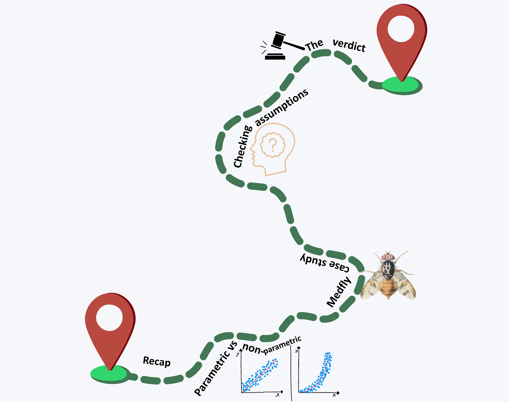
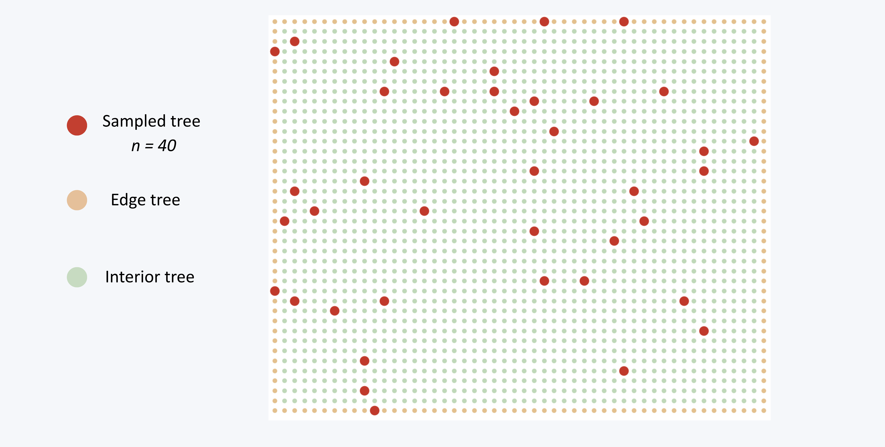
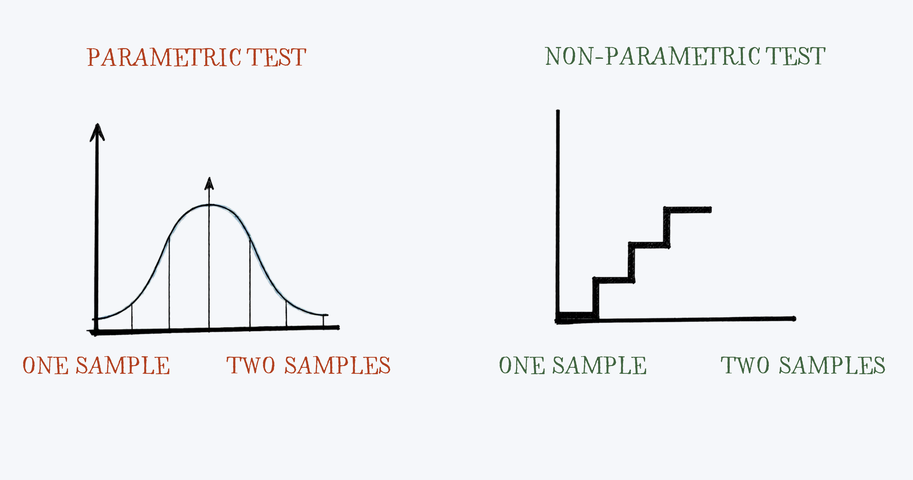

```{r, results='hide', echo=FALSE, warning=FALSE, message=FALSE}
library(webexercises)
library(tidyverse)
library(car)
library(janitor)
mice_parasites <- read.csv("data/mouse_parasite_counts.csv")
```

Welcome to today's workshop extension! In this session, like last time, we will be focusing on summarising and testing our knowledge from what we learnt in the main workbook. We will be covering **Sampling Distributions** and **Testing for Differences**. We will also be revisiting some of the key terms and concepts from the main workbook, and applying them to a different dataset.

## Your Route Through This Workshop

Here is the plan for this session:

1. **Recap**: refresh your understanding of the key terms from the main workbook - sampling, sampling error, SEM, confidence intervals, t-tests, and statistical significance.
2. **Medfly case study**: apply those terms to a real-world scenario, counting flies in a commercial orchard.
3. **Parametric vs non-parametric tests**: revisit the difference between these two types of test, when to use each, and their common equivalents.
4. **Exploring the Medfly data**: load the dataset and use histograms to get a first look at the distribution of fly counts, split by tree type and sex.
5. **Checking assumptions**: use Q-Q plots and the Shapiro-Wilk test to formally check normality, and Levene's test to check for equal variances.
6. **The verdict**: based on the assumption checks, decide whether a parametric t-test is appropriate and run it.

{width=100% fig-align="center"}

By the end, you will have practised the full workflow — from visual inspection of data through to a justified statistical test.

## Open up your Workbook 
In this session it would be best to open up the workshop sheet on Posit, this should be in the usual **BIO_7056A_2026** space, under **workshop_03_sampling_distributions_ext**. This will make it easier to run various bits and pieces in this workshop. 


## Recapping our Definitions

Let's first recap some definitions and key terms from the main workbook. Have a play with the 'Click to expand' button below to familiarise yourself with the definitions, and then we will apply them to a case study.

`r hide("Click to expand: recap of key terms")`

**Sampling**       
Selecting a **subset (sample)** of individuals or observations from a larger population to estimate characteristics of the whole population; without measuring everything.

**Sampling error**        
The difference between a **sample statistic** and the **true population parameter**, arising because a sample may not perfectly represent the population.

**Probability**              
A numerical measure (**between 0 and 1**) of the likelihood that a specific event will occur.

**Variance**               
A measure of how much values differ from the **mean**, calculated as the **average of the squared differences** from the mean.

**Standard deviation**            
The **square root of the variance**, expressed in the original units of the data.

**Standard error of the mean (SEM)**          
An estimate of how much a sample mean is likely to vary from the true population mean: **SD / sqrt(n)**.

**Confidence intervals**          
A range of values, calculated from sample data, likely to contain the **true population parameter** at a given confidence level (e.g. **95%**).

**T-tests**                        
Tests whether the difference between two means is **larger than sampling error alone** would explain.

- *One-sample t-test*: compares a single sample mean to a hypothesised population mean.
- *Two-sample t-test*: compares the means of two independent samples, using the **standard error of the difference between means**.

**Statistical significance**
A result is significant when its **p-value** falls below a chosen threshold (conventionally **p < 0.05**) — meaning the result is unlikely to be due to sampling error, not that the effect is large or important.

`r unhide()`


Now the definitions *should ideally be* fresh in your mind, let's check your understanding with a few multiple choice questions.

**What is a sample?**

`r mcq(c( answer = "A subset of individuals selected from a larger population", "The true value we're trying to estimate", "A calculation error"))`

**What is sampling error?**

`r mcq(c("A mistake in data collection", answer = "The difference between a sample statistic and the true population parameter", "The same as the standard deviation", "A sign that the sampling method was biased"))`

**What is probability?**

`r mcq(c(answer = "A numerical measure between 0 and 1 of how likely an event is", "A measure of spread in the data", "The same as statistical significance", "A range of plausible values for a parameter"))`

**How is variance calculated?**

`r mcq(c("The average of the data values", answer = "The average of the squared differences from the mean", "The square root of the standard deviation", "The difference between two sample means"))`

**What is the standard deviation?**

`r mcq(c("The average of the data", "The same as variance", answer = "The square root of the variance", "SD divided by the square root of n"))`

**How is the standard error of the mean (SEM) calculated?**

`r mcq(c("SD * sqrt(n)", "SD * n", answer = "SD / sqrt(n)", "The same as the standard deviation"))`

**What is a confidence interval?**

`r mcq(c("A range guaranteed to contain every individual value", answer = "A range of values, calculated from sample data, likely to contain the true population parameter at a given confidence level", "The same as the standard deviation", "A test of statistical significance"))`

**What does a t-test assess?**

`r mcq(c(answer = "Whether the difference between two means is larger than sampling error alone would explain", "Whether a sample is biased", "Whether the data are normally distributed", "Whether the variances of two groups are equal"))`

**What does a one-sample t-test do?**

`r mcq(c("Compares two independent samples", answer = "Compares a single sample mean to a hypothesised population mean", "Tests whether variances are equal", "Tests for normality"))`

**What does a two-sample t-test do?**

`r mcq(c(answer = "Compares the means of two independent samples using the standard error of the difference between means", "Compares a sample mean to a fixed value", "Tests whether the data are skewed", "Calculates a confidence interval"))`

**What does statistical significance (p < 0.05) *actually* tell you?**                        

`r mcq(c("That the effect is large and important", answer = "That the result is unlikely to be due to sampling error alone", "That the sampling method was biased", "That the null hypothesis is definitely false"))`

## Medflies in the Orchard - a case study

{width=100% fig-align="center"}

A UEA research team wants to know the average number of **Medflies (*Ceratitis capitata*) per apple tree** in a large commercial orchard containing 2,000 trees. The orchard contains both interior trees and edge trees. Counting flies on every tree is impractical, so the team selects **40 trees at random** and counts the flies caught in a trap on each one.

Results from the 40 sampled trees:

- Sample mean: **14.2 flies/tree**
- Sample standard deviation: **6.5 flies/tree**
- The true mean across all 2,000 trees (found later from a full census) is **13.1 flies/tree**

The team also compares mean fly counts on **edge trees** vs **interior trees**. 

**1. What is the population in this scenario?**

`r mcq(c("The 40 trees that were sampled", answer = "All 2,000 trees in the orchard", "The flies caught in the traps", "The research team"))`

**2. What term describes the 40 trees selected for sampling?**

`r mcq(c("The parameter", "The population", answer = "The sample", "The confidence interval"))`

**3. The true population mean turned out to be 13.1, but the sample mean was 14.2. This difference is best described as:**

`r mcq(c("A calculation mistake", answer = "Sampling error", "A statistically significant effect", "The standard deviation"))`

**4. A colleague argues: *"Since our sample mean (14.2) differs from the true population mean (13.1), our sampling method must have been biased."* Which response best evaluates this claim?**

`r longmcq(c("Correct - any difference between sample and population mean indicates bias in how trees were selected.",answer = paste("Incorrect - a difference between a sample statistic and the true parameter is expected even with","random, unbiased sampling, because of sampling error; only a systematic pattern (e.g. always missing","certain trees) would indicate bias."),"Incorrect - the difference is too small to matter, so no explanation is needed.","Correct, but only because the sample size (40) was too small to ever be unbiased."))`

**5. "The team calculates a 95% confidence interval of 12.0–16.4 flies/tree. Which of the following is the correct interpretation?"**

`r mcq(c("95% probability any single tree has 12.0-16.4 flies","95% of sampled trees had 12.0-16.4 flies",answer = "We are 95% confident this range contains the true population mean","The population mean is definitely in this range"))`

**6. "Comparing mean fly counts between edge trees and interior trees calls for which statistical test?"**

`r mcq(c("One-sample t-test", answer = "Two-sample t-test", "A confidence interval alone", "Calculating variance only"))`

**7. A student claims p = 0.04y for the edge-vs-interior test "proves edge trees definitely have more flies, and the effect must be biologically important." Is there any flaw with this statement?**

`r longmcq(c("No flaw - p < 0.05 definitely proves both statistical and biological significance.",answer = "Yes - statistical significance (p < 0.05) means the difference is unlikely to be due to sampling error alone, but it does not prove anything with certainty, nor does it tell us whether the effect is biologically meaningful.", "Yes - p = 0.03 actually indicates no significant difference.", "Yes - only because the sample sizes for edge and interior trees were unequal."))`


## Parametric and Non-Parametric Tests

{width=100% fig-align="center"}
We learnt in the main workbook about parametric and non-parametric tests, and how to choose between them.

**What is a parametric test and what is a non-parametric test?**

`r longmcq(c("A parametric test makes no assumption about the distribution of the data; a non-parametric test assumes the data follow a normal distribution.", "Both parametric and non-parametric tests assume the data follow a normal distribution.", "Neither parametric nor non-parametric tests make any assumptions about the distribution of the data.", answer = "A parametric test assumes the data follow a normal distribution; a non-parametric test makes no assumption about the distribution of the data."))`

So to confirm, **parametric tests** (like the t-test) assume that the underlying data are normally distributed. We have previously checked the visualisation of the data using **historgrams** these show the skew of the data. If the data are skewed, that assumption may be violated, which can make the test's results unreliable. However, this doesn't automatically mean the test result is wrong — it depends on how much the skew is actually affecting the outcome, and we learnt that we can check in two ways:

 **(1) Remove the influential point(s):** Re-run the test excluding the datapoint(s) responsible for the skew, and compare the results. If the conclusion changes, the skew is likely having a meaningful effect on your result.        
  **(2) Compare test types**: Run both a parametric test (e.g. a t-test) and its *non-parametric equivalent* on the same data. If both tests lead to the same conclusion, you can be more confident that the skew is **not** distorting your result.

I have mentioned above that you can use non parametric equivalents when your data don't meet the assumptions of parametric tests. The table below shows the most commonnly known pairings:

| Parametric test | Non-parametric equivalent |
|---|---|
| One-sample t-test | Wilcoxon signed-rank test |
| Two-sample t-test (unpaired) | Mann-Whitney U test |
| Two-sample t-test (paired) | Wilcoxon signed-rank test |
| Pearson correlation | Spearman correlation |
| One-way analysis of variance | Kruskal-Wallis test |

: Common parametric tests and their non-parametric equivalents,  (Field, A. (2024)) {.striped .hover}

                    
                                                      
                
### Putting this into action                                                                    
                                
                                                                                                          
First, **load your packages and read in the data**. As in the previous workshop, we will use the `tidyverse` package. The dataset `medfly_orchard_data.csv` can be found in the data folder of the `workshop_03_sampling_distributions_ext` space on Posit, but it will also be in blackboard if you would like to practise uploading data to R. Read the data in and name the object `medfly_orchard`. As before, keep your script neat by loading all packages at the top. If you need reminder of how to read in a CSV file, check the previous chapter for a refresher. 
                                                                                                        
                                    
                      

```{r, echo=FALSE, results='hide'}
medfly_orchard <- read.csv("data/medfly_orchard_data.csv")
```


We have learned about using histograms to see the distribution of the data, learning about its shape, centre and spread. We want to know if we can use a parametric or a non parametric test on our Medfly data, so lets start with some histograms. There is a lot in our data that we can see, lets first have a quick run of some of the terms we learnt last week. 


`r hide("Click to show examples of checking out the data")`
```{r, results='hide', message=FALSE, warning=FALSE}
# (1). Dimensions/Size:
nrow(medfly_orchard) # number of rows, Base R
ncol(medfly_orchard) # number of columns, Base R

# (2). Structure/Variable Names:
colnames(medfly_orchard) # variable names, Base R
str(medfly_orchard) # summary of the data structure, Base R
glimpse(medfly_orchard) # summary of the data structure, tidyverse

# (3). Viewing the Actual Data: 
head(medfly_orchard) # first 6 rows, Base R
tail(medfly_orchard) # last 6 rows, Base R

# (4). Starting to Summarise the Data: 
summary(medfly_orchard) # summary of the data, Base R
tabyl(medfly_orchard, sex) # frequency / percentage, janitor
tabyl(medfly_orchard, tree_type) # frequency / percentage, janitor
```
       
`r unhide()`

Let's now make some histograms of the `fly_count` variable in the `medfly_orchard` dataset. We will start by looking at the overall distribution of fly counts across all 40 sampled trees.

```{r}
medfly_orchard_histogram_fly_count <- medfly_orchard %>%  
  ggplot(aes(x = fly_count)) +
  geom_histogram(binwidth = 2, fill = "lightblue", colour = "black") +
  labs(x = "Fly count per tree", y = "Number of trees")

medfly_orchard_histogram_fly_count
```


Looking at this histogram, we can see that the data does not follow a neat bell-shaped curve. Instead, there appear to be **two clusters**; a group of trees with relatively low fly counts (around 1–5 flies), and a larger group with higher fly counts (around 13–17 flies), with a noticeable dip in between. This suggests that the data may not be normally distributed, which is an important consideration when deciding whether to use a parametric or non-parametric test. However, it also asks more about what's going on with the data and why there are two groups. We can split the data by tree type (edge vs interior) and sex (male vs female) to see if that explains the two clusters. Let's generate those 4 histograms. 

```{r}
medfly_orchard_histogram_tree_type <- medfly_orchard %>%
  ggplot(aes(x = fly_count, fill = tree_type)) +
  geom_histogram(binwidth = 2, colour = "black") +
  facet_wrap(~ tree_type) +
  labs(x = "Fly count per tree", y = "Number of trees") +
  theme(legend.position = "none")
medfly_orchard_histogram_tree_type

```

Edge trees tend to have higher fly counts (peaking around 14–22 flies), while interior trees are more spread out with some very low counts. This likely explains the two clusters we saw in the overall histogram.
```{r}
medfly_orchard_histogram_sex <- medfly_orchard %>%
  ggplot(aes(x = fly_count, fill = sex)) +
  geom_histogram(binwidth = 2, colour = "black") +
  facet_wrap(~ sex) +
  labs(x = "Fly count per tree", y = "Number of trees")+
  theme(legend.position = "none")


medfly_orchard_histogram_sex
```

 Female trees show a clearer peak around 15–17 flies, while male trees are more spread out with no obvious pattern — though this may partly reflect the smaller male sample size (n = 15) rather than a true biological difference.

So we've just generated a bunch of histograms to look at the distribution of fly counts in our Medfly dataset. We can see that the data may not be normally distributed, and that there are differences between tree types and sexes. Histograms are a good first step in checking for normality, but we can also use a **Q-Q plot**. So we've just generated a bunch of histograms to look at the distribution of fly counts in our Medfly dataset. We can see that the data may not be normally distributed, and that there are differences between tree types and sexes. Histograms are a good first step in checking for normality, but with small sample sizes they can be hard to interpret — a distribution can look irregular simply due to chance rather than reflecting a true departure from normality.     

A more reliable visual tool is a Q-Q plot (quantile-quantile plot). This sounds more complicated than it is — all it does is plot your actual data values against what you would expect to see if the data were perfectly normal. If your data are normally distributed, the points will fall roughly along a straight diagonal line. If the points curve away from the line, this suggests the data are not normally distributed.


```{r}
ggplot(medfly_orchard, aes(sample = fly_count)) +
  stat_qq() +
  stat_qq_line() +
  facet_wrap(~ tree_type) +
  labs(x = "Theoretical quantiles",
       y = "Sample quantiles")

ggplot(medfly_orchard, aes(sample = fly_count)) +
  stat_qq() +
  stat_qq_line() +
  facet_wrap(~ sex) +
  labs(x = "Theoretical quantiles",
       y = "Sample quantiles")

```

Neither group shows a perfectly straight line, but none show dramatic departures from normality either. However, visual inspection alone is not enough — we should confirm this with a formal test. We will now use the Shapiro-Wilk test to formally assess whether each group is normally distributed, which will help us decide whether a parametric t-test is appropriate.


The Shapiro-Wilk test formally tests whether a dataset is normally distributed. It produces a W statistic and a p-value:
If p > 0.05 — we do not have enough evidence to reject normality; we can proceed with a parametric test
If p < 0.05 — the data significantly depart from normality; we should consider a non-parametric test

```{r}
medfly_orchard %>%
  group_by(tree_type) %>%
  summarise(
    shapiro_w = shapiro.test(fly_count)$statistic,
    shapiro_p = shapiro.test(fly_count)$p.value
  )

medfly_orchard %>%
  group_by(sex) %>%
  summarise(
    shapiro_w = shapiro.test(fly_count)$statistic,
    shapiro_p = shapiro.test(fly_count)$p.value
  )
```

All four groups pass the Shapiro-Wilk test (p > 0.05), suggesting that the data are approximately normally distributed within each group. This means the first point of a using a parametric test is satisfied. However, we also need to check the second assumption of a t-test: that the variances of the two groups are approximately equal. We can do this using Levene's test.

```{r}
leveneTest(fly_count ~ tree_type, data = medfly_orchard)
leveneTest(fly_count ~ sex, data = medfly_orchard)
```

Levene's test suggests that the variances between groups are not significantly different for either tree type (p = 0.347) or sex (p = 0.969). This means we can proceed with a standard t-test rather than Welch's t-test.
Combining this with our Shapiro-Wilk results, both assumptions of the t-test are met:
✓ Normality — Shapiro-Wilk p > 0.05 for all groups
✓ Equal variances — Levene's test p > 0.05 for both comparisons
We can therefore confidently use a standard two-sample t-test to compare fly counts between edge and interior trees, and between female and male trees.


Now that we have confirmed both assumptions are met, we can run the two-sample t-test to compare fly counts between groups.
```{r}
t.test(fly_count ~ tree_type, data = medfly_orchard, var.equal = TRUE)
t.test(fly_count ~ sex, data = medfly_orchard, var.equal = TRUE)
```

Edge trees had a significantly higher mean fly count than interior trees (edge: 18.33 flies/tree, interior: 12.89 flies/tree; t = 2.566, p = 0.014). This result is statistically significant (p < 0.05), suggesting that tree position within the orchard is associated with fly count.

There was no statistically significant difference in fly counts between female and male trees (female: 15.48 flies/tree, male: 12.93 flies/tree; t = 1.193, p = 0.240). We therefore do not have enough evidence to conclude that sex is associated with fly count in this sample.

## The End 
Today's workbook was a step up from last weeks, and we covered a lot of ground. We recapped the key terms from the main workbook, and applied them to a case study on Medflies. We also revisited parametric and non-parametric tests, and applied them to the wood mice parasite data.
