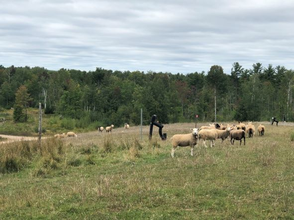

```{r setup, include=FALSE}
knitr::opts_chunk$set(
  echo    = TRUE,
  warning = FALSE,
  message = FALSE
)

library(ggplot2)
library(dplyr)
library(knitr)
library(kableExtra)
library(webexercises)
library(tidyverse)
library(janitor)
library(DescTools)
library(car)
library(patchwork)

grassland_species <- read_csv("data/grassland_species.csv") 
 
```

## The route through today's workshop 
In the main workbook, you should have been introduced to experimental design and ANOVA. In this workshop, we will go through the following:

1. Recapping our terms 
2. Understanding experimental design through a case study of vegetation management.           
    2.1 Completley Randomised Design (CRD).           
    2.2 Randomised Complete Block Design (RCBD).           
    2.3 Latin Square Design (LSD).           
    2.4 Split Plot Design.           
3. Introducing ANOVA               
    3.1 One-way ANOVA using vegetation case study            
    3.2 Two-way ANOVA using vegetation case study                   


### Package reading alert! 
Today we will need: `tidyverse`, `janitor`, `car`. This is a new work page, so please make sure you have installed these packages and loaded them into the script.


## Coming to terms with the terms 

**Randomisation** is the process of randomly assigning treatments to experimental units. It eliminates systematic bias and ensures results are representative of the population.

**Replication** is the use of multiple experimental units per treatment. It increases the reliability and precision of estimates, and allows you to separate true treatment effects from random variation.

---

## Understanding Experimental Design; the case study of vegatation.

{width=100% fig-align="center"}

Today we will test our understanding of expeirmental design by looking at a case study of the effect of **vegetation management treatment** on **plant species richness** in a lowland grassland.

Researchers have 20 grassland plots and want to test the effect of four different treatment on plant species richness. The treatments are:

The four treatments are:

- **T1**: Unmanaged control  
- **T2**: Autumn cutting  
- **T3**: Spring burning  
- **T4**: Sheep grazing  

They can only test one treatment per plot, and they want to have **5 replicates** of each treatment, so they need to know how they can decide which treatment goes in which plot. This will need to be done randomly. 

**What is the purpose of randomisation in an experiment?**

`r mcq(c("To ensure all plots are the same size", answer = "To eliminate systematic bias and ensure results are representative of the population", "To reduce the number of plots needed", "To make the experiment easier to manage"))`

**What is replication in an experimental design?**

`r mcq(c("Repeating the entire experiment from scratch", answer = "Using multiple experimental units per treatment to increase reliability and precision", "Applying the same treatment to every plot", "Taking measurements from the same plot twice"))`

                                
Using this case study, let's go through the terms we learnt in the main workbook to establish how we could assign which treatment to which plot. 

### Completely Randomised Design (CRD)
In a completely randomised design (CRD), treatments are assigned to experimental units **purely at random**, with no restrictions or grouping. It is the simplest valid experimental design.


The treatment list is completely **shuffled at random** and assigned to plots. I will show you how this can be done in R code. 

In R, the `sample()` function randomly shuffles the treatment list, and `set.seed()` ensures the result is reproducible.


`r hide("Click to show: R code for plot randomisation")`                                                 


```{r randomise}
set.seed(99)

treatments <- rep(c("Control", "Autumn Cut", "Spring Burn", "Sheep Grazing"), each = 5)

field_plan <- data.frame(
  plot      = 1:20,
  treatment = sample(treatments),
  col       = rep(1:5, times = 4),
  row       = rep(4:1, each = 5))

field_plan
```

`r unhide()`                                 
                                                                       
We can visualise this this using `ggplot` to see the arrangement of the plots in the field:
`r hide("Click to show: R code for field layout visualisation")`
```{r, fig.cap="Figure 1. Completely Randomised Design. Treatments are assigned to plots purely at random.", fig.width=7, fig.height=5}
field_plan_plot <- ggplot(field_plan, aes(x = col, y = row, fill = treatment)) +
  geom_tile(colour = "white", linewidth = 1.2) +
  geom_text(aes(label = plot), size = 4, fontface = "bold", colour = "white") +
  labs(title = "Completely Randomised Design", fill = "Treatment") +
  theme_minimal(base_size = 13) +
  theme(
    panel.grid = element_blank(),
    axis.title = element_blank(),
    axis.text  = element_blank()
  )
```

`r unhide()`                            

<br>
                                           
                                                                                                                                                          
```{r echo=FALSE, fig.cap="Figure 1. Completely Randomised Design. Treatments are assigned to plots purely at random.", fig.width=7, fig.height=5}
ggplot(field_plan, aes(x = col, y = row, fill = treatment)) +
  geom_tile(colour = "white", linewidth = 1.2) +
  geom_text(aes(label = plot), size = 4, fontface = "bold", colour = "white") +
  labs(title = "Completely Randomised Design", fill = "Treatment") +
  theme_minimal(base_size = 13) +
  theme(
    panel.grid = element_blank(),
    axis.title = element_blank(),
    axis.text  = element_blank()
  )
```

    
As you can see if you visualise it from afar, the treatments are mostly **scattered randomly** across the field. However, there are *some* of the same treatments right next to eachother and this could be considered a problem. 
          
Because treatments are assigned **purely at random**, there is no guarantee they will be spread evenly across the field. By chance, all five replicates of one treatment could end up on the same side. This would be a problem if those plots differed systematically in soil moisture, nutrient levels, or light availability, as any observed differences between treatments might simply reflect these **environmental gradients** rather than the treatments themselves.

In our randomly assigned field layout above, we can see that the treatments are fairly evenly spread, but we were quite lucky in that example. Although what is below is done manually, it could be that random assignement may result in a field layout like below: 

`r hide("Click to show code for a poor CRD outcome")`

```{r}
bad_plan <- data.frame(
  plot      = 1:20,
  treatment = c(rep("Control", 5),
                rep("Autumn Cut", 5),
                rep("Spring Burn", 5),
                rep("Sheep Grazing", 5)),
  col       = rep(1:5, times = 4),
  row       = rep(4:1, each = 5)
)


bad_plan_plot <- ggplot(bad_plan, aes(x = col, y = row, fill = treatment)) +
  geom_tile(colour = "white", linewidth = 1.2) +
  geom_text(aes(label = plot), size = 4, fontface = "bold", colour = "white") +
  labs(title = "A poor CRD outcome", fill = "Treatment") +
  theme_minimal(base_size = 13) +
  theme(
    panel.grid = element_blank(),
    axis.title = element_blank(),
    axis.text  = element_blank()
  )
```

`r unhide()`
<br>

```{r, echo=FALSE, fig.cap="Figure 2. A poor CRD outcome. All replicates of one treatment ended up in the same part of the field, confounding treatment effects with environmental gradients.", fig.width=7, fig.height=5}

ggplot(bad_plan, aes(x = col, y = row, fill = treatment)) +
  geom_tile(colour = "white", linewidth = 1.2) +
  geom_text(aes(label = plot), size = 4, fontface = "bold", colour = "white") +
  labs(title = "A poor CRD outcome", fill = "Treatment") +
  theme_minimal(base_size = 13) +
  theme(
    panel.grid = element_blank(),
    axis.title = element_blank(),
    axis.text  = element_blank()
  )
```

As written above, with a Completely Randomised Design, there is a risk that all replicates of one treatment could end up in the same part of the field (you can see an example of this with the visualisation above), in our case study, this would confound treatment effects with environmental gradients. This is the main weakness of a CRD.

**In a Completely Randomised Design, how are treatments assigned in our case study?**

`r mcq(c("Treatments are assigned in alphabetical order", "Treatments are assigned based on plot location", answer = "Treatments are assigned to experimental units purely at random", "Treatments are assigned within blocks"))`

**What is the main weakness of a Completely Randomised Design in our case study?**

`r longmcq(c(answer = "By chance, all replicates of one treatment could end up in the same part of the field.", "It requires too many plots to be practical.", "It cannot be used with more than two treatments.", "It does not allow for replication."))`

### Blocked Design (BD)

In a **blocked design**, the experimental area is divided into **blocks** that are as homogeneous as possible. Within each block, treatments are randomly assigned to the plots. This approach helps to control for variability due to environmental gradients or other factors that might affect the response variable.

In plain terms: think of the field as being divided into **5 strips** (the repeats), each containing **4 plots** (the treatments). Within each strip, every treatment appears exactly once — but the order is randomised. So instead of scattering all 20 plots randomly across the whole field, we say:

> *"In strip 1, one plot gets Control, one gets Autumn Cut, one gets Spring Burn, and one gets Sheep Grazing, but we randomly decide which plot gets which."*

Then we do the same for strips 2, 3, 4 and 5.

This guarantees that **every treatment appears in every part of the field**. If there is a moisture gradient running across the field, each treatment will experience a range of conditions, rather than one treatment accidentally getting all the wet plots.

`r hide("Click to show: example of a blocked design outcome")`
```{r, ig.cap="Figure 3. Randomised Complete Block Design. Each row is a block (strip) containing one replicate of each treatment, randomised within the block.", fig.width=7, fig.height=5}

set.seed(42)

blockeddesign_plan <- data.frame(
  
  # Plot numbers 1 to 20, one for each experimental unit
  plot      = 1:20,
  
  # 5 blocks of 4 plots each — rep(1:5, each = 4) repeats each block number 
  # 4 times before moving to the next: 1,1,1,1,2,2,2,2,3,3,3,3...
  block     = rep(1:5, each = 4),
  
  # Treatments are randomly assigned within each block using sample()
  # Each block gets exactly one of each treatment, in a random order
  # This is repeated separately for each of the 5 blocks
  treatment = c(sample(c("Control", "Autumn Cut", "Spring Burn", "Sheep Grazing")),
                sample(c("Control", "Autumn Cut", "Spring Burn", "Sheep Grazing")),
                sample(c("Control", "Autumn Cut", "Spring Burn", "Sheep Grazing")),
                sample(c("Control", "Autumn Cut", "Spring Burn", "Sheep Grazing")),
                sample(c("Control", "Autumn Cut", "Spring Burn", "Sheep Grazing"))),
  
  # Column position for plotting — cycles 1 to 4 across each block row
  # rep(1:4, times = 5) gives: 1,2,3,4,1,2,3,4,1,2,3,4...
  col       = rep(1:4, times = 5),
  
  # Row position for plotting — counts down from 5 to 1 so block 1 
  # appears at the top of the figure and block 5 at the bottom
  # rep(5:1, each = 4) gives: 5,5,5,5,4,4,4,4,3,3,3,3...
  row       = rep(5:1, each = 4)
)


blocked_design_plot <- ggplot(blockeddesign_plan, aes(x = col, y = row, fill = treatment)) +
  geom_tile(colour = "white", linewidth = 1.2) +
  geom_text(aes(label = paste0("Plot ", plot)), 
            size = 3, fontface = "bold", colour = "white") +
  # Add block labels on the left hand side
  annotate("text", 
           x = 0.3, 
           y = 5:1, 
           label = paste("Block", 1:5), 
           hjust = 1, 
           size = 3.5, 
           fontface = "bold") +
  # Add thick lines between blocks
  geom_hline(yintercept = c(1.5, 2.5, 3.5, 4.5), 
             linewidth = 1.5, colour = "black") +
  labs(title = "Blocked Design", 
       fill = "Treatment") +
  theme_minimal(base_size = 13) +
  theme(
    panel.grid = element_blank(),
    axis.title = element_blank(),
    axis.text  = element_blank()
  ) +
  coord_cartesian(xlim = c(0.5, 4.5))
```

`r unhide()`
<br>

```{r, echo=FALSE, fig.cap="Figure 3. Randomised Complete Block Design. Each row is a block (strip) containing one replicate of each treatment, randomised within the block.", fig.width=7, fig.height=5}
ggplot(blockeddesign_plan, aes(x = col, y = row, fill = treatment)) +
  geom_tile(colour = "white", linewidth = 1.2) +
  geom_text(aes(label = paste0("Plot ", plot)), 
            size = 3, fontface = "bold", colour = "white") +
  # Add block labels on the left hand side
  annotate("text", 
           x = 0.3, 
           y = 5:1, 
           label = paste("Block", 1:5), 
           hjust = 1, 
           size = 3.5, 
           fontface = "bold") +
  # Add thick lines between blocks
  geom_hline(yintercept = c(1.5, 2.5, 3.5, 4.5), 
             linewidth = 1.5, colour = "black") +
  labs(title = "Blocked Design", 
       fill = "Treatment") +
  theme_minimal(base_size = 13) +
  theme(
    panel.grid = element_blank(),
    axis.title = element_blank(),
    axis.text  = element_blank()
  ) +
  coord_cartesian(xlim = c(0.5, 4.5))
```


The key advantage of a blocked design is that any differences between the selected blocks, such as a moisture gradient running across the field, are **accounted for in the analysis** rather than absorbed into the error. This makes it much easier to detect true treatment effects. However, the blocked design cannot deal with **ALL** trends across the experimental area. For example, there are still 3 sheep grazing treatments on the left hand side. Thus, we introduce; The Latin Square Design (LSD).

**In a Blocked Design, what is a block?**

`r longmcq(c("A large plot that receives only one treatment, ensuring a large area is covered for accuracy", answer = "A group of experimental units that are as similar as possible, within which each treatment appears exactly once", "A completely randomised set of plots, this allows for there to be no bias", "A plot that is left untreated as a control for comparison"))`

**Why is a Blocked Design an improvement over a Completely Randomised Design?**

`r longmcq(c("It requires fewer plots because each treatment only needs to appear once across the whole field, reducing the total number of experimental units needed.",answer = "It ensures every treatment appears in every part of the field, so environmental gradients such as soil moisture or light availability are spread evenly across treatments rather than confounded with them.","It eliminates all sources of variation by making every plot identical, so any differences between plots can be attributed entirely to the treatment effect.","It allows more treatments to be tested simultaneously by subdividing each block into as many plots as needed, regardless of how many treatments are being compared."))`


```{r, echo = FALSE}
limitation_choices <- c(
  "It cannot be used with more than four treatments, as each block must contain exactly one replicate of each treatment and larger numbers make the blocks too large to be homogeneous.",
  "It requires too many replicates relative to other designs, as each treatment must appear in every block, making it impractical when resources or plot numbers are limited.",
  "It cannot account for trends that run across the experimental area in more than one direction — for example, a gradient running diagonally across the field would not be controlled for by blocks arranged in one direction only.",
  "It does not allow randomisation within blocks, meaning treatments are always assigned in the same order across blocks, which can introduce systematic bias into the results."
)
```

**What is the key limitation of a Blocked Design?**

`r longmcq(c(limitation_choices[1], limitation_choices[2], answer = limitation_choices[3], limitation_choices[4]))`


### The Latin Square Design (LSD)
The Latin Square Design (LSD) is a more complex design that can account for trends in two directions. Imagine that as well as a moisture gradient running left to right across the field, there is also a temperature gradient running top to bottom. A blocked design can control for one of these, but not both at the same time.

The **Latin Square Design** solves this by controlling for variation in **two directions simultaneously**, across rows *and* across columns. Every treatment appears exactly once in each row and exactly once in each column

::: {.callout-note}
**The trade-off:** moving to a Latin Square means reducing the number of plots from 20 to 16 in our example. You need the number of treatments to equal the number 
of rows and columns, which limits flexibility.
:::

A Latin Square design can be randomly generated in R before you do your experiment, as below: 

<br>

`r hide("Click to show: R code for Latin Square field layout and visualisation")`

        
```{r lsd, fig.cap="Figure 4. Latin Square Design. Each treatment appears exactly once in each row and each column.", fig.width=6, fig.height=5}

lsd_plan <- data.frame(
  col       = rep(1:4, times = 4),
  row       = rep(4:1, each = 4),
  treatment = c("Control",      "Autumn Cut",   "Spring Burn",  "Sheep Grazing",
                "Autumn Cut",   "Control",      "Sheep Grazing","Spring Burn",
                "Spring Burn",  "Sheep Grazing","Control",      "Autumn Cut",
                "Sheep Grazing","Spring Burn",  "Autumn Cut",   "Control")
)

lds_plan_plot <- ggplot(lsd_plan, aes(x = col, y = row, fill = treatment)) +
  geom_tile(colour = "white", linewidth = 1.2) +
  geom_text(aes(label = treatment), size = 3, fontface = "bold", colour = "white") +
  labs(title = "Latin Square Design", fill = "Treatment") +
  theme_minimal(base_size = 13) +
  theme(
    panel.grid = element_blank(),
    axis.title = element_blank(),
    axis.text  = element_blank()
  )
```

`r unhide()`

<br>

```{r echo=FALSE, fig.cap="Figure 4. Latin Square Design. Each treatment appears exactly once in each row and each column.", fig.width=6, fig.height=5}
ggplot(lsd_plan, aes(x = col, y = row, fill = treatment)) +
  geom_tile(colour = "white", linewidth = 1.2) +
  geom_text(aes(label = treatment), size = 3, fontface = "bold", colour = "white") +
  labs(title = "Latin Square Design", fill = "Treatment") +
  theme_minimal(base_size = 13) +
  theme(
    panel.grid = element_blank(),
    axis.title = element_blank(),
    axis.text  = element_blank()
  )
```

**In a Latin Square Design, how many times does each treatment appear in each row and column?**

`r mcq(c("Never", "Twice", answer = "Exactly once", "As many times as there are treatments"))`

**If you have 9 treatments and want to use a Latin Square Design, how many plots do you need?**

`r mcq(c("20", "45", answer = "81", "8"))`

**What is the key advantage of a Latin Square Design over Blocked Design?**

`r longmcq(c("It requires fewer plots", "It allows more replicates per treatment", answer = "It controls for variation in two directions simultaneously; across both rows and columns", "It eliminates the need for randomisation"))`

### Split Plot Design

Sometimes practical constraints make full randomisation impossible. In our grassland 
experiment, imagine we want to test two things:

1. Whether the field has been **managed or unmanaged** in the past
2. Which **vegetation management treatment** works best

The problem is that we can only apply past management history to **large areas** of 
the field at once — we cannot go back in time and manage individual small plots 
differently. So we use a split plot design:

**Stage 1 — the whole-plot factor:**
The field is divided into two large areas — one that has been **managed** in the past, 
and one that has been **unmanaged**. This is our whole-plot factor.

**Stage 2 — the split-plot factor:**
Each large area is then divided into smaller plots, within which our four vegetation 
management treatments (Control, Autumn Cut, Spring Burn, Sheep Grazing) are 
**completely randomised**.

> *The factor we cannot control at a fine scale (past management history) goes on 
the large areas. The factor we can control (vegetation treatment) is randomised 
within those large areas.*

`r hide("Click to show: split plot layout")`

```{r split-plot}
set.seed(42)

split_plan <- data.frame(
  col        = rep(1:4, times = 4),
  row        = rep(4:1, each = 4),
  # Whole-plot factor: past management history
  whole_plot = rep(c("Previously Managed", "Previously Unmanaged"), each = 8),
  # Split-plot factor: vegetation management treatment
  treatment  = c(
    sample(c("Control", "Autumn Cut", "Spring Burn", "Sheep Grazing")),
    sample(c("Control", "Autumn Cut", "Spring Burn", "Sheep Grazing")),
    sample(c("Control", "Autumn Cut", "Spring Burn", "Sheep Grazing")),
    sample(c("Control", "Autumn Cut", "Spring Burn", "Sheep Grazing")))
)


treatment_colours <- c(
  "Control"       = "#F8766D",
  "Autumn Cut"    = "#7CAE00",
  "Spring Burn"   = "#00BFC4",
  "Sheep Grazing" = "#C77CFF"
)

ggplot(split_plan, aes(x = col, y = row, fill = treatment)) +
  geom_tile(colour = "white", linewidth = 1.2) +
  geom_text(aes(label = treatment),
            size = 3, fontface = "bold", colour = "white") +
  # Thick line separating managed from unmanaged
  geom_hline(yintercept = 2.5, linewidth = 2.5, colour = "black") +
  # Whole plot labels on the right
  annotate("text",
           x = 4.7, y = c(1.5, 3.5),
           label = c("Previously\nUnmanaged", "Previously\nManaged"),
           hjust = 0, size = 3.5, fontface = "bold") +
  # Bracket showing whole plot area
  annotate("segment",
           x = 4.6, xend = 4.6,
           y = 2.6, yend = 4.4,
           linewidth = 1, colour = "black") +
  annotate("segment",
           x = 4.6, xend = 4.6,
           y = 0.6, yend = 2.4,
           linewidth = 1, colour = "black") +
  scale_fill_manual(values = treatment_colours) +
  labs(title = "Split Plot Layout",
       subtitle = "Whole-plot factor: past management history\nSplit-plot factor: vegetation management treatment",
       fill = "Vegetation treatment") +
  coord_cartesian(xlim = c(0.5, 6)) +
  theme_minimal(base_size = 13) +
  theme(
    panel.grid = element_blank(),
    axis.title = element_blank(),
    axis.text  = element_blank()
  )


```

`r unhide()`

```{r split-plot-figure, echo=FALSE, fig.cap="Figure 5. Split plot design for the grassland experiment. The field is divided into two large areas based on past management history (whole-plot factor): previously managed (top) and previously unmanaged (bottom), separated by the thick black line. Within each large area, the four vegetation management treatments (Control, Autumn Cut, Spring Burn, Sheep Grazing) are completely randomised across the smaller plots (split-plot factor)."}

treatment_colours <- c(
  "Control"       = "#F8766D",
  "Autumn Cut"    = "#7CAE00",
  "Spring Burn"   = "#00BFC4",
  "Sheep Grazing" = "#C77CFF"
)

ggplot(split_plan, aes(x = col, y = row, fill = treatment)) +
  geom_tile(colour = "white", linewidth = 1.2) +
  geom_text(aes(label = treatment),
            size = 3, fontface = "bold", colour = "white") +
  # Thick line separating managed from unmanaged
  geom_hline(yintercept = 2.5, linewidth = 2.5, colour = "black") +
  # Whole plot labels on the right
  annotate("text",
           x = 4.7, y = c(1.5, 3.5),
           label = c("Previously\nUnmanaged", "Previously\nManaged"),
           hjust = 0, size = 3.5, fontface = "bold") +
  # Bracket showing whole plot area
  annotate("segment",
           x = 4.6, xend = 4.6,
           y = 2.6, yend = 4.4,
           linewidth = 1, colour = "black") +
  annotate("segment",
           x = 4.6, xend = 4.6,
           y = 0.6, yend = 2.4,
           linewidth = 1, colour = "black") +
  scale_fill_manual(values = treatment_colours) +
  labs(title = "Split Plot Layout",
       subtitle = "Whole-plot factor: past management history\nSplit-plot factor: vegetation management treatment",
       fill = "Vegetation treatment") +
  coord_cartesian(xlim = c(0.5, 6)) +
  theme_minimal(base_size = 13) +
  theme(
    panel.grid = element_blank(),
    axis.title = element_blank(),
    axis.text  = element_blank()
  )
```

Looking at this layout:

- The **top half** of the field was previously managed — the four vegetation 
treatments have been randomly assigned within this area
- The **bottom half** was previously unmanaged — the four vegetation treatments 
have again been randomly assigned within this area
- The **thick black line** separates the two whole-plot areas
- Within each half, the four treatments appear in a **different random order** — 
this is the split-plot randomisation

::: {.callout-note}
This design allows us to test not only the effect of vegetation treatment on species 
richness, but also whether the **history of the field** affects how well each 
treatment works — in other words, whether there is an **interaction** between past 
management and current treatment.
:::

**What is the whole-plot factor in this split plot design?**

`r mcq(c("Vegetation management treatment", answer = "Past management history (managed vs unmanaged)", "Species richness", "Plot size"))`

**Why is past management history assigned to large areas rather than individual plots?**

`r longmcq(c(answer = "Because past management history cannot be randomised at a fine scale — it is a property of large areas of the field that cannot be changed for individual small plots.", "Because it is less important than the vegetation treatment.", "Because it is easier to measure at a large scale.", "Because small plots cannot be managed differently."))`


### Repeated Measures Design

A **repeated measures design** is used when measurements are taken from the **same 
experimental unit more than once** over time.

In our grassland experiment, imagine instead of measuring species richness just once, 
we measure it **every year for 5 years** after applying the treatments. Each plot is 
measured repeatedly — this is a repeated measures design.

In plain terms:

> *Rather than measuring different plots at each time point, you follow the same 
plots over time.*


::: {.callout-tip}
**When to use a repeated measures design:**
Use it whenever you measure the same experimental unit more than once — for example 
measuring the same animal, plant, or plot at multiple time points.
:::

**What is a repeated measures design?**

`r longmcq(c(answer = "A design where measurements are taken from the same experimental unit more than once over time.", "A design where different experimental units are measured at each time point.", "A design where treatments are applied repeatedly to different plots.", "A design where the same treatment is applied to every plot."))`

**Why must a repeated measures design be analysed differently from a standard design?**

`r longmcq(c(answer = "Because observations from the same unit over time are not independent — the analysis must account for both the treatment effect and the temporal sequence of measurements.", "Because there are too many data points to analyse normally.", "Because the treatments change at each time point.", "Because replication is not possible in repeated measures designs."))`

**In our grassland experiment, what would make it a repeated measures design?**

`r longmcq(c(answer = "Measuring species richness in the same plots every year for several years after applying the treatments.", "Applying the same treatment to every plot.", "Measuring species richness in different plots at each time point.", "Using more than four treatments."))`


::: {.callout-tip}
**Summary of experimental designs:**

| Design | Controls for | Use when |
|---|---|---|
| Completley Randomised Design | Nothing | Plots are uniform |
| Blocked Design | Variation in one direction | One known gradient |
| Latin Square Design | Variation in two directions | Two known gradients |
| Split Plot Design | Practical constraints on randomisation | Equipment or logistics limit full randomisation |
| Repeated Measures Design | Non-independence of repeated observations | Same unit measured multiple times |
:::


**What type of design is used when measurements are taken from the same experimental unit more than once?**

`r mcq(c("Latin Square Design", "Split plot design", "Completely Randomised Design", answer = "Repeated measures design"))`

**Which design would be most appropriate if you know there is a moisture gradient running across your field from left to right?**

`r mcq(c("Completely Randomised Design", answer = "Randomised Complete Block Design", "Repeated measures design", "Split plot design"))`

**Which design would be most appropriate if you know there are gradients running both left to right AND top to bottom across your field?**

`r mcq(c("Completely Randomised Design", "Randomised Complete Block Design", answer = "Latin Square Design", "Repeated measures design"))`
                            
## Analysis of Variance (ANOVA)

### What is ANOVA?

So far we have used t-tests to compare the means of **two groups**. But what if we 
want to compare **more than two groups** at once? In our grassland experiment, we have 
four treatments: Control, Autumn Cut, Spring Burn, and Sheep Grazing. When we have 
more than two groups to compare, we use **ANOVA** (Analysis of Variance).

ANOVA asks one overarching question:

> *"Is there enough evidence to suggest that at least one treatment produces a different mean response from the others?"*

**Why can we not just run multiple t-tests to compare all four treatments?**

`r longmcq(c("Because t-tests can only be used with two groups and ANOVA is always more accurate.", "Because t-tests do not produce p-values.", answer = "Running multiple t-tests increases the chance of a false positive result, the more tests you run, the more likely you are to find a significant result by chance alone.", "Because ANOVA is simpler to run than multiple t-tests."))`


### The Null Hypothesis

Like all statistical tests, ANOVA starts with a **null hypothesis**: a statement 
that there is no effect or difference. In the context of ANOVA, the null hypothesis 
states that:

> *All treatment means are equal.*

If the probability of this being true is less than 1 in 20 (p < 0.05), we reject 
the null hypothesis and conclude that at least one treatment mean is different from 
the others.

> *If p is significant, the null hypothesis is rejected.*


**In our grassland experiment, we are testing whether vegetation treatment affects species richness. What is the null hypothesis?**

`r longmcq(c("At least one treatment produces a different mean species richness.", "Species richness is normally distributed within each treatment group.", "The variances of all four treatment groups are equal.", answer = "All four treatment means are equal, there is no difference in species richness between Control, Autumn Cut, Spring Burn and Sheep Grazing."))`

**If p = 0.032 in an ANOVA, what do we conclude?**

`r longmcq(c(answer = "We reject the null hypothesis: at least one treatment mean is significantly different from the others.", "We accept the null hypothesis: all treatment means are equal.", "We conclude that all treatments are significantly different from each other.", "We conclude that the data are not normally distributed."))`


### How Does ANOVA Work?

ANOVA works by comparing two types of variation in the data:

**1. Within-group variance: the background noise**

Imagine you have 5 Control plots. You would expect them all to have a similar number 
of plant species, because they all received the same treatment. But in reality they 
will not be identical, one plot might have 8 species, another 10, another 7. This 
is the natural variation that exists even though the treatment was the same.

> *Within-group variance measures how different plots are from each other within the 
same treatment group, the natural background noise that exists regardless of 
treatment.*

To calculate this, we look at how far each plot's value is from its **group mean**, 
square those differences (so that negative and positive differences do not cancel 
each other out), and add them all up. This is called the **within-group sum of 
squares (SSW)**.

::: {.callout-note}
**Important:** a significant ANOVA result tells you that *at least one* treatment mean is different, but not *which* ones differ. For that, you need a **post-hoc test.**
:::

**Which of the following would contribute to within-group variance?**

`r longmcq(c(answer = "Two Control plots having different species richness values, even though they received the same treatment.", "The mean species richness of Control plots being higher than the mean of Sheep Grazing plots.", "The F-ratio being greater than 1.", "The Shapiro-Wilk test returning p > 0.05."))`

**If the within-group sum of squares is very large, what does this suggest?**

`r longmcq(c("The treatments are having a strong effect on species richness.", answer = "There is a lot of natural background variation within treatment groups, plots receiving the same treatment are very different from each other.", "The F-ratio will be large and the result will be significant.", "The data are not normally distributed."))`


**2. Between-group variance: the treatment signal**

Now imagine comparing the **average** species richness across the four treatment 
groups. If the treatments have no effect, these averages should all be similar. If 
treatments do have an effect, the averages will differ more than you would expect 
from background noise alone.

> *Between-group variance measures how different the treatment group means are from each other: the signal we are hoping to detect.*

**Which of the following would contribute to between-group variance?**

`r longmcq(c("Two Control plots having slightly different species richness values.", "The standard deviation within the Autumn Cut group being large.", "The Shapiro-Wilk test returning p < 0.05 for one group.", answer = "The mean species richness of Sheep Grazing plots (12.8) being much higher than the mean of Control plots (8.8)."))`

**If the between-group variance is similar in size to the within-group variance, what does this suggest?**

`r longmcq(c("The treatments are definitely having a significant effect.", answer = "The treatments are probably not having a meaningful effect — the differences between group means are no larger than the background noise within groups.", "The data are normally distributed.", "The F-ratio will be much greater than 1."))`


### The F-ratio

ANOVA combines these two estimates into a single value called the **F-ratio**:

$$F = \frac{\text{Between-group variance}}{\text{Within-group variance}}$$

- If the two variances are **similar in size**, F will be close to **1**, meaning the treatment signal is being drowned out by background noise
- If the between-group variance is **much larger** than the within-group variance, F will be **greater than 1** — the treatment signal stands out clearly

> *The larger the F-ratio, the more convincing the evidence that at least one treatment is producing a genuinely different result.*


**If the F-ratio is close to 1, what does this tell us?**

`r longmcq(c("The result is definitely significant.", "The null hypothesis is definitely true.", answer = "The between-group variance and within-group variance are similar in size, there is little evidence of a treatment effect.", "The data are not normally distributed."))`

**If the F-ratio is 15.3, what does this suggest?**

`r longmcq(c(answer = "The between-group variance is much larger than the within-group variance, there is strong evidence that at least one treatment is producing a different result.", "The p-value is definitely less than 0.05.", "All four treatment means are significantly different from each other.", "The within-group variance is larger than the between-group variance."))`

**A student says: 'A significant ANOVA result proves that Sheep Grazing produces higher species richness than all other treatments.' Is this correct?**

`r longmcq(c("Yes, a significant ANOVA result tells us exactly which treatments differ.", answer = "No, a significant ANOVA result only tells us that at least one treatment mean is different. We need a post-hoc test to find out which specific treatments differ from each other.", "Yes, the treatment with the highest mean is always significantly different from all others.", "No, a significant ANOVA result means none of the treatments differ."))`


---

## One-Way ANOVA

::: {.callout-tip}
A **one-way ANOVA** is used when you have **one factor** and want to test whether 
its levels produce different means. In our grassland experiment, that one factor is 
**treatment**.
:::

### Step 1: Read in and Check the Data

For the one-way ANOVA, we will use `grassland_species.csv` — this dataset contains 
treatment and species richness only, with no soil type variable.

```{r read-one-way}
grassland_species <- read.csv("data/grassland_species.csv")
```

`r hide("Click to show: data checks")`

```{r check-one-way, results='hide'}
nrow(grassland_species)
ncol(grassland_species)
colnames(grassland_species)
glimpse(grassland_species)
head(grassland_species)
summary(grassland_species)
tabyl(grassland_species, treatment)
```

`r unhide()`

```{r clean-one-way}
grassland_species_clean <- grassland_species %>%
  mutate(treatment = as.factor(
    str_to_lower(str_replace_all(treatment, " ", "_"))))
```

### Step 2: Visualise the Data

```{r one-way-boxplot, fig.cap="Figure 5. Species richness by treatment group."}
ggplot(grassland_species_clean, 
       aes(x = treatment, y = richness, fill = treatment)) +
  geom_boxplot(colour = "black") +
  geom_jitter(width = 0.1, size = 2, colour = "black") +
  labs(x = "Treatment", y = "Species richness") +
  theme_minimal(base_size = 13) +
  theme(legend.position = "none")
```

**Based on the boxplot, which treatment appears to produce the highest species 
richness?**

`r mcq(c("control", "spring_burn", answer = "sheep_grazing", "autumn_cut"))`

**Which two treatments appear most similar to each other?**

`r mcq(c(answer = "autumn_cut and sheep_grazing", "control and spring_burn", 
"control and autumn_cut", "spring_burn and sheep_grazing"))`

`r hide("Click to show explanation")`

Looking at the mean species richness values:

| Treatment | Mean species richness |
|---|---|
| control | 8.8 |
| spring_burn | 8.4 |
| autumn_cut | 12.6 |
| sheep_grazing | 12.8 |

**Autumn Cut** and **Sheep Grazing** are only 0.2 species apart, while **Control** 
and **Spring Burn** also sit close together at the lower end. This suggests the 
treatments fall into two broad groups — which a post-hoc test will confirm.

`r unhide()`

### Step 3: Check Assumptions

```{r one-way-assumptions}
# Shapiro-Wilk test
grassland_species_clean %>%
  group_by(treatment) %>%
  summarise(
    shapiro_w = shapiro.test(richness)$statistic,
    shapiro_p = shapiro.test(richness)$p.value
  )

# Levene's test
leveneTest(richness ~ treatment, data = grassland_species_clean)
```

**What does a Shapiro-Wilk p-value above 0.05 tell us?**

`r longmcq(c(answer = "The data within that group are approximately normally distributed, so the normality assumption is satisfied.", "The data are significantly non-normal and a non-parametric test must be used.", "The variances between groups are equal.", "The ANOVA result will definitely be significant."))`

**What does Levene's test assess, and what does a p-value above 0.05 indicate?**

`r longmcq(c(answer = "Levene's test checks whether the variances across treatment groups are approximately equal; a p-value above 0.05 suggests the equal variances assumption is satisfied.", "Levene's test checks whether the data are normally distributed.", "Levene's test checks whether the treatment means are significantly different.", "Levene's test checks whether the sample sizes are equal across groups."))`

### Step 4: Run the One-Way ANOVA

```{r one-way-anova}
anova_one_way <- aov(richness ~ treatment, data = grassland_species_clean)
summary(anova_one_way)
```

| Column | What it means |
|---|---|
| `Df` | Degrees of freedom |
| `Sum Sq` | Sum of squares |
| `Mean Sq` | Mean square (Sum Sq / Df) |
| `F value` | The F-ratio |
| `Pr(>F)` | The p-value |

**If the p-value is less than 0.05, what can we conclude?**

`r longmcq(c(answer = "At least one treatment mean is significantly different from the others, but we do not yet know which ones differ.", "All treatment means are significantly different from each other.", "The null hypothesis is definitely true.", "We should use a non-parametric test instead."))`

::: {.callout-note}
A significant one-way ANOVA tells us **at least one** treatment differs — but not 
which ones. We will cover post-hoc tests shortly.
:::

---

## Two-Way ANOVA

::: {.callout-tip}
A **two-way ANOVA** is used when you have **two factors** and want to test not only 
whether each factor has an effect, but whether the two factors **interact** with each 
other — in other words, whether the effect of one factor depends on the level of the 
other.
:::

In our grassland experiment, we now have two factors:

- **Treatment**: Control, Autumn Cut, Spring Burn, Sheep Grazing
- **Soil type**: clay vs sandy

The key question the two-way ANOVA adds is:

> *"Does the effect of treatment on species richness depend on soil type?"*

### What is an Interaction?

An interaction occurs when the effect of one factor **changes depending on the level of another factor**. For example:

> *"Sheep Grazing increases species richness on sandy soil, but not on clay soil."*

If this were true, we would say there is an **interaction between treatment and soil 
type**. The best treatment would depend on the soil — you cannot give one answer 
without knowing the other factor.

::: {.callout-note}
**No interaction** — the lines on an interaction plot are roughly parallel.        
**Interaction present** — the lines cross or converge, showing the effect of one 
factor changes across levels of the other.
:::

### Step 1: Read in and Check the Data

For the two-way ANOVA, we will use `grassland_species_v2.csv` — this dataset includes the soil type variable.

```{r read-two-way}
grassland_species_v2 <- read.csv("data/grassland_species_v2.csv")
```

`r hide("Click to show: data checks")`

```{r check-two-way, results='hide'}
nrow(grassland_species_v2)
ncol(grassland_species_v2)
colnames(grassland_species_v2)
glimpse(grassland_species_v2)
head(grassland_species_v2)
summary(grassland_species_v2)
tabyl(grassland_species_v2, treatment)
tabyl(grassland_species_v2, soil_type)
```

`r unhide()`

Like before, we will need to clean the treatment variable to make it easier to work with, and convert soil type and treatment to a factor. 
```{r clean-two-way}
grassland_species_v2_clean <- grassland_species_v2 %>%
  mutate(
    treatment = as.factor(str_to_lower(str_replace_all(treatment, " ", "_"))),
    soil_type = as.factor(soil_type)
  )
```

### Step 2: Visualise the Data

```{r two-way-boxplot, fig.cap="Figure 7. Species richness by treatment group and soil type."}
ggplot(grassland_species_v2_clean, 
       aes(x = treatment, y = richness, fill = treatment)) +
  geom_boxplot(colour = "black") +
  facet_wrap(~ soil_type) +
  labs(x = "Treatment", y = "Species richness") +
  theme_minimal(base_size = 13) +
  theme(
    legend.position = "none",
    axis.text.x = element_text(angle = 45, hjust = 1)
  )
```

**Which treatment produces the highest species richness on clay soil?**

`r mcq(c("control", answer = "autumn_cut", "spring_burn", "sheep_grazing"))`

**Which treatment produces the highest species richness on sandy soil?**

`r mcq(c("control", "autumn_cut", "spring_burn", answer = "sheep_grazing"))`

**What does this pattern suggest?**

`r longmcq(c(answer = "The effect of treatment depends on soil type — this is an interaction effect.", "Soil type has no effect on species richness.", "Treatment has no effect on species richness.", "All treatments produce the same richness regardless of soil type."))`

### Step 3: Check Assumptions

```{r two-way-assumptions}
grassland_species_v2_clean %>%
  group_by(treatment, soil_type) %>%
  summarise(
    shapiro_w = shapiro.test(richness)$statistic,
    shapiro_p = shapiro.test(richness)$p.value,
    .groups = "drop"
  )

leveneTest(richness ~ treatment * soil_type, 
           data = grassland_species_v2_clean)
```

::: {.callout-note}
With only 3 replicates per group, the Shapiro-Wilk test has very limited power. 
In practice, visual inspection and subject knowledge are just as important as 
formal tests with such small sample sizes.
:::

### Step 4: Run the Two-Way ANOVA

```{r two-way-anova}
anova_two_way <- aov(richness ~ treatment * soil_type, 
                     data = grassland_species_v2_clean)
summary(anova_two_way)
```

The output now has four rows:

| Row | What it tests |
|---|---|
| `treatment` | Main effect of treatment |
| `soil_type` | Main effect of soil type |
| `treatment:soil_type` | Interaction between treatment and soil type |
| `Residuals` | Within-group variance (background noise) |

**If the interaction term is significant (p < 0.05), what does this mean?**

`r longmcq(c(answer = "The effect of treatment on species richness depends on soil type — the best treatment differs between clay and sandy soils.", "Both treatment and soil type have significant main effects.", "Neither treatment nor soil type has any effect.", "The ANOVA assumptions have been violated."))`

**If the interaction is significant, should we focus on the main effects?**

`r longmcq(c("Yes — the main effects are always the most important part.", answer = "No — when an interaction is significant, the main effects can be misleading. We should interpret the interaction directly and use a post-hoc test.", "Yes — the interaction can be ignored if main effects are significant.", "No — a significant interaction means the ANOVA result is invalid."))`

### Step 5: Visualise the Interaction

```{r interaction-plot, fig.cap="Figure 8. Interaction plot showing mean species richness by treatment and soil type."}
grassland_species_v2_clean %>%
  group_by(treatment, soil_type) %>%
  summarise(mean_richness = mean(richness), .groups = "drop") %>%
  ggplot(aes(x = treatment, y = mean_richness, 
             colour = soil_type, group = soil_type)) +
  geom_line(linewidth = 1.2) +
  geom_point(size = 3) +
  labs(x = "Treatment", 
       y = "Mean species richness",
       colour = "Soil type") +
  theme_minimal(base_size = 13) +
  theme(axis.text.x = element_text(angle = 45, hjust = 1))
```

**What does crossing lines in an interaction plot indicate?**

`r longmcq(c(answer = "The effect of treatment reverses depending on soil type — a classic interaction effect.", "The two soil types produce identical results.", "The ANOVA result is not significant.", "The data are not normally distributed."))`

::: {.callout-note}
Notice how the lines cross between Autumn Cut and Sheep Grazing — Autumn Cut 
produces higher richness on clay, while Sheep Grazing produces higher richness 
on sandy soil. This crossing pattern is the visual signature of an interaction.
:::